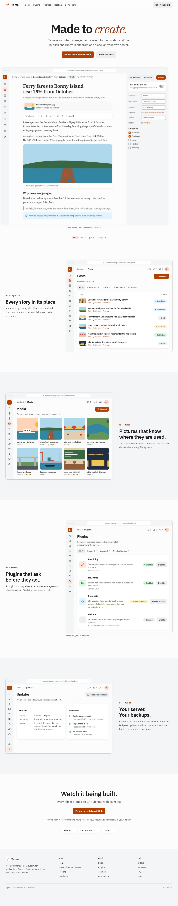

# TemeCMS: the theme of temecms.com

The theme of [temecms.com](https://temecms.com), the TemeCMS project's own website: a product home page, documentation, plugin and theme directories, a migration page, hosting, developers, FAQ, roadmap and a blog.

- Package: `temecms/theme-temecms`
- Theme code: `temecms`
- Licence: MIT



## Requirements

- TemeCMS `^0.9`
- To rebuild the assets, seed the content or run the browser checks: Node.js 20.11 or later
- For the browser checks: Google Chrome (the checks drive it through Playwright)

## Install

From the admin: open the theme installer, choose to install from a Git address, and give it

```
https://github.com/temecms/theme-temecms
```

Or with Composer, in the Teme install's folder (once the package is on Packagist):

```bash
composer require temecms/theme-temecms
```

Then check it and link its public files:

```bash
php artisan teme:theme:check temecms
php artisan teme:themes:link
```

and activate it under Site › Themes.

To work on a local copy instead, add the theme's folder, as an absolute path, to `TEME_THEME_PATHS` in the Teme install's `.env`.

## Build the assets

The built assets in `public/build` are committed, so an install needs no build step. After changing anything under `assets/`:

```bash
npm ci
npm run build          # Vite writes public/build
```

## What it draws

| Template | Draws |
|---|---|
| `single-page-home` | The home page: opening, four stops, closing |
| `single-page-landing`, `-faq`, `-roadmap`, `single-page` | Pages made of an opening and sections; questions; three columns; plain pages |
| `archive-doc`, `single-doc` | The documentation home, and a guide with its tree, proof mark, "On this page", previous and next |
| `archive-plugin`, `single-plugin` | The plugin directory (search, categories, rows) and a plugin's page |
| `archive-theme`, `single-theme` | The theme directory and a theme's page |
| `latest`, `single`, `archive`, `search` | The blog, a post, categories and tags, search |
| `notfound`, `error`, `index` | Not found, errors, the fallback |

Page templates an editor can pick: Default, Home, Landing (an opening, then sections), Questions and answers, Roadmap (three columns).

### How a page's content becomes sections

Landing, home, FAQ and roadmap pages split their content at horizontal rules: the first part is the opening, every later part a section. Inside a section:

- a paragraph that is only bold text is the small label above the section's heading;
- an `h2` is the section's heading; `h3` headings followed by paragraphs become cards (two or more make a grid);
- a paragraph that is only a bold link is drawn as a quiet button;
- a numbered list is drawn as steps, and a picture as a picture with its caption.

## Menus

| Slot | Where |
|---|---|
| `primary` | The header |
| `footer-teme`, `footer-build`, `footer-project` | The footer's three columns |
| `docs-editors`, `docs-operators`, `docs-developers` | The documentation's three guides |

## Regions

| Region | Where | Cards |
|---|---|---|
| `home-latest` | Home page: from the blog | featured posts (one) |
| `after-content` | After the content of a page or post | callout, button, site code, featured posts |
| `blog-intro` | Blog: opening text | callout, button, image |
| `docs-intro` | Documentation: opening text | callout, button, image |
| `plugins-intro` | Plugins: opening text | callout, button, image |
| `plugins-how` | Plugins: how they work | callout, button, image |
| `themes-intro` | Themes: opening text | callout, button, image |
| `themes-build` | Themes: build a theme | callout, button, image |

Fill them under Content › Regions.

## Settings

Under Site › Themes:

| Setting | Default |
|---|---|
| Maker line (footer) | Made by Krafty Sprouts Media. |
| The follow link's words | Follow the build |
| The follow link's address (https only) | https://github.com/temecms |
| Status line (foot of every page) | Alpha · Not public yet · 0.7.0-alpha.1 |
| Licence line (empty shows none) | MIT licence |
| Show the latest blog posts on the home page | off |
| Documentation version label | 0.7 |

## Put the site's content in

The `seed` folder holds the whole temecms.com site: pages, posts, guides, plugin and theme entries, product pictures, menus, regions and settings. The content is Tiptap JSON (never HTML), written in `seed/content/*.mjs` with the helpers in `seed/lib.mjs` and compiled to `seed/content.json`, which is committed. The seed makes everything through Teme's own Operations, never in SQL.

It needs:

- a Teme install with this theme installed (see above), and its database migrated;
- an administrator in that install: `SEED_ADMIN_ID` is that user's ID (default `1`);
- Teme's testing kit (the `Teme\Testing` classes) loadable in that install, since the seed acts through it as that administrator.

After editing `seed/content/*.mjs`, compile the content again:

```bash
node seed/build-content.mjs        # seed/content/*.mjs -> seed/content.json
```

Then, from the Teme install's folder:

```bash
SEED_ADMIN_ID=1 php /path/to/theme-temecms/seed/seed.php types fields media theme content regions menus settings addresses activate
```

| Step | Does |
|---|---|
| `types` | Adds the content types Guide (`/docs/{slug}/`), Plugin (`/plugins/{slug}/`) and Theme |
| `fields` | Adds their fields, and the page fields kicker and emphasis |
| `media` | Uploads the product pictures in `seed/media` with their alt text |
| `theme` | Makes `temecms` the site's theme (before `content`: a page picks its template from the active theme) |
| `content` | Makes and publishes every page, post, guide, plugin and theme entry, with links between them stored as IDs |
| `regions` | Fills the theme's regions |
| `menus` | Makes the menus and puts them in the theme's slots |
| `settings` | Sets the site's title and tagline |
| `addresses` | Moves the theme directory to `/theme-directory/{slug}/` (core serves theme assets from `/themes/`) |
| `activate` | Makes the home page the front page and the blog page the posts page |

`theme`, `settings` and `activate` change the site's theme, title and front page, so run them only on a site meant for this content. Steps are repeatable: what exists already, by slug or by `seed/.state.json`, is reused, never duplicated. Published items are left alone unless their type is named in `SEED_FORCE`, as in `SEED_FORCE=page,doc`.

## Tests

The theme's tests use Teme's testing kit. From the Teme install's folder:

```bash
php artisan test /path/to/theme-temecms/tests
```

They check what the theme alone decides: which template answers each address, the one `h1`, the footer's words and the follow link from the theme's settings.

Browser checks of the seeded site, at 1280 and 375 wide: status 200, one `h1`, heading order, alt text and image sizes, no sideways scroll, and no axe violation. Point `BASE` at the site; it defaults to `http://localhost:8000`:

```bash
npm ci
BASE=http://localhost:8000 node tests/pages.mjs          # report in tests/.output/report.json
BASE=http://localhost:8000 node tests/screenshots.mjs    # full-page shots into docs/screenshots
```

## Licence

MIT, copyright Krafty Sprouts Media, LLC. See [LICENSE](LICENSE). The IBM Plex fonts in `public/fonts` are under the SIL Open Font License; see `public/fonts/OFL-ibm-plex.txt`.
